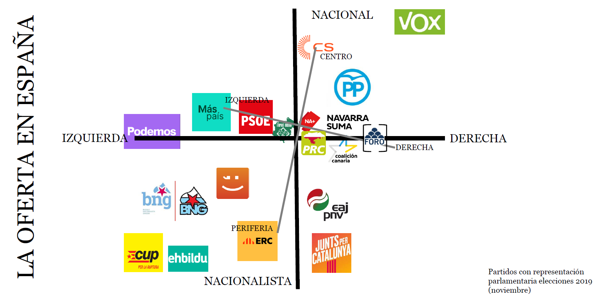
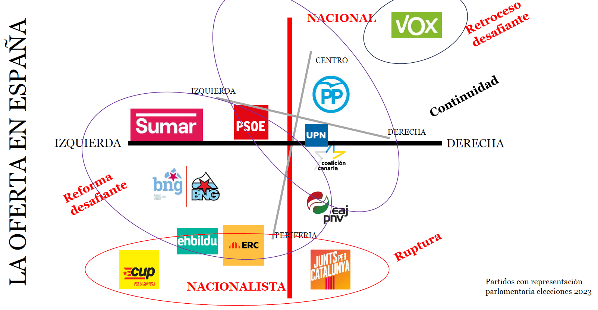

```{ojs}
//| output: false
congreso = FileAttachment("datos/congreso_2023.json").json()
nep = (await FileAttachment("datos/nep.csv").csv({typed: true})).map(d => ({...d, etiqueta: String(d.etiqueta)}))

ordenHemiciclo = ["CUP", "SUMAR", "BILDU", "ERC", "BNG", "PSOE", "PNV", "CC", "JUNTS", "UPN", "PP", "VOX"]

function hemiciclo(partidos, filas = 9, r0 = 0.42) {
  const total = d3.sum(partidos, p => p.es);
  const radios = d3.range(filas).map(i => r0 + (1 - r0) * i / (filas - 1));
  const sumR = d3.sum(radios);
  const porFila = radios.map(r => Math.round(total * r / sumR));
  porFila[filas - 1] += total - d3.sum(porFila);
  const asientos = [];
  radios.forEach((r, i) => {
    const n = porFila[i];
    for (let j = 0; j < n; j++) {
      const a = Math.PI - Math.PI * j / (n - 1);
      asientos.push({a, r, x: r * Math.cos(a), y: r * Math.sin(a)});
    }
  });
  asientos.sort((p, q) => q.a - p.a || p.r - q.r);
  const lista = partidos.slice().sort((p, q) => ordenHemiciclo.indexOf(p.k) - ordenHemiciclo.indexOf(q.k));
  let k = 0;
  for (const p of lista) for (let i = 0; i < p.es; i++) Object.assign(asientos[k++], {partido: p.n, c: p.c});
  return asientos;
}
```

## Hoja de ruta

::: {.tarjetas style="--n:4"}
::: {.tarjeta style="--c:#555"}
[1. La teoría]{.tt}
¿Qué tipos de sistemas de partidos hay y cómo se miden?
:::
::: {.tarjeta style="--c:#b3261e"}
[2. España]{.tt}
Dos ejes de competición y los partidos del Congreso de 2023.
:::
::: {.tarjeta style="--c:#1d84ce"}
[3. La oferta]{.tt}
Cómo ha cambiado el mapa de partidos entre 2019 y 2023.
:::
::: {.tarjeta style="--c:#9b2226"}
[4. Tarragona]{.tt}
Los partidos que compiten en nuestra provincia.
:::
:::

# 1 · Tipos de sistemas de partidos {background-color="#1b1b1b"}

## ¿Qué es un sistema de partidos?

No es solo **cuántos** partidos hay, sino **cómo se relacionan** entre sí.

::: {.tarjetas style="--n:2"}
::: {.tarjeta style="--c:#555"}
[Número (fragmentación)]{.tt}
¿Cuántos partidos **cuentan** de verdad? Solo los que pueden gobernar o tienen capacidad de chantaje (sin ellos no hay mayoría).
:::
::: {.tarjeta style="--c:#b3261e"}
[Distancia ideológica (polarización)]{.tt}
¿Cuánto se separan los extremos? ¿Hay partidos **antisistema** que rechazan las reglas del juego?
:::
:::

::: {.chico}
Giovanni Sartori, *Partidos y sistemas de partidos* (1976): combinando número y distancia salen los distintos tipos.
:::

## La tipología de Sartori {.smaller}

::: {.tabla-peq}
| Tipo | Cómo funciona | Ejemplo |
|---|---|---|
| **Partido único** | Solo un partido es legal. | China, la URSS |
| **Partido hegemónico** | Hay otros partidos, pero no pueden ganar. | México con el PRI (hasta 2000) |
| **Partido predominante** | Hay competencia libre, pero el mismo partido gana una y otra vez. | Japón (PLD), Andalucía (PSOE, 1982-2018) |
| **Bipartidismo** | Dos partidos se alternan y gobiernan solos. | Reino Unido, EE. UU. |
| **Pluralismo moderado** | 3-5 partidos relevantes, poca distancia ideológica, **competición centrípeta** y gobiernos de coalición por bloques. | Alemania, Países Bajos, España hoy |
| **Pluralismo polarizado** | 6 o más partidos, partidos antisistema en ambos extremos, **competición centrífuga**. | República de Weimar, Italia (1948-1992) |
| **Atomizado** | Tantos partidos que ninguno pesa. | Sistemas en formación |
:::

::: notes
Centrípeta: los partidos compiten hacia el centro para captar al votante moderado. Centrífuga: los extremos crecen y el centro se vacía. El debate actual en España es si la polarización nos acerca al pluralismo polarizado.
:::

## Cómo se mide: el número efectivo de partidos

Laakso y Taagepera (1979) proponen una fórmula que "pesa" a cada partido por su tamaño:

<div style="text-align:center;font-size:1.3em;margin:.4em 0"><b>NEP</b> = 1 / Σ p<sub>i</sub>²</div>

::: {.chico style="text-align:center"}
p<sub>i</sub> es la proporción de votos (o escaños) de cada partido.
:::

::: {.tarjetas style="--n:3"}
::: {.tarjeta style="--c:#1d84ce"}
[Dos partidos al 50 %]{.tt}
1 / (0,5² + 0,5²) = **2**
:::
::: {.tarjeta style="--c:#e07a5f"}
[60 % + 30 % + 10 %]{.tt}
1 / (0,36 + 0,09 + 0,01) ≈ **2,2**
:::
::: {.tarjeta style="--c:#9b2226"}
[Cinco partidos al 20 %]{.tt}
1 / (5 × 0,04) = **5**
:::
:::

::: {.chico}
Se puede calcular con los **votos** (lo que quieren los votantes) o con los **escaños** (lo que sale del sistema electoral).
:::

## España: número efectivo de partidos, 1977-2023

```{ojs}
{
  const largo = nep.flatMap(d => [
    {etiqueta: d.etiqueta, serie: "Por votos", v: d.nep_votos},
    {etiqueta: d.etiqueta, serie: "Por escaños", v: d.nep_escanos}
  ]);
  const etiquetas = nep.map(d => d.etiqueta);
  return Plot.plot({
    width: 1040, height: 420, marginTop: 30, marginBottom: 45,
    x: {domain: etiquetas, label: null, type: "point", padding: 0.4, tickFormat: d => d.replace(" (", "\n(")},
    y: {domain: [0, 7], label: "↑ Número efectivo de partidos", grid: true},
    color: {domain: ["Por votos", "Por escaños"], range: ["#9b2226", "#1d84ce"], legend: true},
    marks: [
      Plot.ruleY([2], {stroke: "#1b1b1b", strokeDasharray: "4 4", strokeOpacity: .5}),
      Plot.text([{x: "2008", t: "Bipartidismo puro = 2"}], {x: "x", y: 2, text: "t", dy: 12, fontSize: 14, fill: "#555"}),
      Plot.line(largo, {x: "etiqueta", y: "v", stroke: "serie", strokeWidth: 3}),
      Plot.dot(largo, {x: "etiqueta", y: "v", fill: "serie", r: 5}),
      Plot.text(largo, {x: "etiqueta", y: "v", text: d => d.v.toFixed(1).replace(".", ","), dy: d => d.serie === "Por votos" ? -14 : 16, fontSize: 13, fill: "serie"})
    ]
  });
}
```

::: {.fuente}
Fuente: Ministerio del Interior. Elaboración propia. La diferencia entre las dos líneas es el efecto reductor del sistema electoral.
:::

::: notes
En 2008 el número efectivo por escaños fue de 2,3: casi bipartidismo puro. En 2019 se acercó a 5 escaños y 6 votos. En 2023 baja a 3,4 por la recuperación de PP y PSOE.
:::

# 2 · El caso español {background-color="#1b1b1b"}

## Dos ejes de competición

::: {.columns}
::: {.column width="50%"}
**Eje izquierda-derecha** (clivaje de clase)

- Economía, impuestos, Estado del bienestar, valores.
- En él compiten todos los partidos.
:::
::: {.column width="50%"}
**Eje centro-periferia** (clivaje territorial)

- Modelo de Estado: centralismo, autonomía, federalismo, independencia.
- Muy fuerte en Cataluña, el País Vasco, Galicia, Navarra y Canarias.
:::
:::

::: {.tarjetas style="--n:2"}
::: {.tarjeta style="--c:#1d84ce"}
[Partidos de ámbito estatal (PAE)]{.tt}
Se presentan en toda España: PSOE, PP, Vox, Sumar…
:::
::: {.tarjeta style="--c:#e8890c"}
[Partidos de ámbito no estatal (PANE)]{.tt}
Solo en su territorio: ERC, Junts, PNV, EH Bildu, BNG, CC, UPN…
:::
:::

::: {.chico}
Por eso en Cataluña o el País Vasco funciona un **sistema de partidos propio**, distinto del español.
:::

## Así evoluciona el sistema

::: {.tarjetas style="--n:3"}
::: {.tarjeta style="--c:#2e9e5b"}
[1977-1982 · Pluralismo moderado]{.tt}
UCD, PSOE, PCE, AP y nacionalistas. La UCD se hunde en 1982.
:::
::: {.tarjeta style="--c:#1d84ce"}
[1982-2011 · Bipartidismo imperfecto]{.tt}
PSOE y PP se alternan. Cuando no tienen mayoría absoluta, pactan con **CiU, PNV o CC**: los nacionalistas actúan de **bisagra**.
:::
::: {.tarjeta style="--c:#9b2226"}
[2015-hoy · Pluralismo de bloques]{.tt}
Llegan Podemos, Cs y Vox. Se compite **por bloques** (izquierda + nacionalistas frente a derecha) y suben la fragmentación y la **polarización**.
:::
:::

::: {.chico}
Hoy el debate es si España sigue en el **pluralismo moderado** o si la polarización la acerca al **pluralismo polarizado** de Sartori.
:::

## El Congreso de 2023

::: {.columns}
::: {.column width="64%"}
```{ojs}
{
  const asientos = hemiciclo(congreso);
  return Plot.plot({
    width: 680, height: 380, margin: 10, marginBottom: 10,
    x: {axis: null, domain: [-1.05, 1.05]}, y: {axis: null, domain: [-0.05, 1.05]},
    marks: [
      Plot.dot(asientos, {x: "x", y: "y", fill: "c", r: 5.6, title: "partido"}),
      Plot.text(["350 escaños"], {x: 0, y: 0.2, fontSize: 22, fontWeight: 700, fill: "#333"}),
      Plot.text(["mayoría absoluta: 176"], {x: 0, y: 0.08, fontSize: 15, fill: "#555"})
    ]
  });
}
```
:::
::: {.column width="36%"}
```{ojs}
html`<table class="tabla-esc mini">
  <tr><th>Partido</th><th>% voto</th><th>Escaños</th></tr>
  ${congreso.slice().sort((a, b) => ordenHemiciclo.indexOf(a.k) - ordenHemiciclo.indexOf(b.k)).map(p => html`<tr style="background:${p.c}22">
    <td><span style="display:inline-block;width:.8em;height:.8em;background:${p.c};border-radius:2px"></span> ${p.n}</td>
    <td>${p.pct.toLocaleString("es-ES", {minimumFractionDigits: 1, maximumFractionDigits: 1})}</td>
    <td><b>${p.es}</b></td></tr>`)}
</table>`
```
:::
:::

::: {.chico}
**11 partidos** con escaño. Investidura de Sánchez (noviembre de 2023): **179** votos a favor (PSOE, Sumar, ERC, Junts, EH Bildu, PNV, BNG y CC).
:::

## Los partidos del Congreso de 2023 {.smaller}

::: {.tabla-peq}
<table class="tabla-partidos">
<tr><th>Partido</th><th style="text-align:right">Escaños</th><th>Eje izquierda-derecha</th><th>Eje territorial</th><th>Familia ideológica</th></tr>
<tr style="background:#e6007e22"><td><span class="punto" style="background:#e6007e"></span><b>Sumar</b></td><td style="text-align:right">31</td><td>Izquierda</td><td>Estatal, plurinacional</td><td>Coalición de izquierdas (IU, Más Madrid, Comuns, Compromís…)</td></tr>
<tr style="background:#8a9a0a22"><td><span class="punto" style="background:#8a9a0a"></span><b>EH Bildu</b></td><td style="text-align:right">6</td><td>Izquierda</td><td>Independentista vasco</td><td>Izquierda <i>abertzale</i></td></tr>
<tr style="background:#e8890c22"><td><span class="punto" style="background:#e8890c"></span><b>ERC</b></td><td style="text-align:right">7</td><td>Izquierda</td><td>Independentista catalán</td><td>Republicanismo de izquierdas</td></tr>
<tr style="background:#3aa0c422"><td><span class="punto" style="background:#3aa0c4"></span><b>BNG</b></td><td style="text-align:right">1</td><td>Izquierda</td><td>Nacionalista gallego</td><td>Izquierda nacionalista</td></tr>
<tr style="background:#e3061322"><td><span class="punto" style="background:#e30613"></span><b>PSOE</b></td><td style="text-align:right">121</td><td>Centro-izquierda</td><td>Estatal</td><td>Socialdemócrata</td></tr>
<tr style="background:#0b6b3a22"><td><span class="punto" style="background:#0b6b3a"></span><b>PNV</b></td><td style="text-align:right">5</td><td>Centro-derecha</td><td>Nacionalista vasco</td><td>Democristiano</td></tr>
<tr style="background:#d9b80022"><td><span class="punto" style="background:#d9b800"></span><b>CC</b></td><td style="text-align:right">1</td><td>Centro</td><td>Nacionalista canario</td><td>Regionalista</td></tr>
<tr style="background:#00a99d22"><td><span class="punto" style="background:#00a99d"></span><b>Junts</b></td><td style="text-align:right">7</td><td>Centro-derecha</td><td>Independentista catalán</td><td>Liberal, heredero de CiU</td></tr>
<tr style="background:#a3324a22"><td><span class="punto" style="background:#a3324a"></span><b>UPN</b></td><td style="text-align:right">1</td><td>Centro-derecha</td><td>Regionalista navarro</td><td>Conservador</td></tr>
<tr style="background:#1d84ce22"><td><span class="punto" style="background:#1d84ce"></span><b>PP</b></td><td style="text-align:right">137</td><td>Centro-derecha</td><td>Estatal</td><td>Liberal-conservador, democristiano</td></tr>
<tr style="background:#5aa31f22"><td><span class="punto" style="background:#5aa31f"></span><b>Vox</b></td><td style="text-align:right">33</td><td>Derecha radical</td><td>Estatal, recentralizador</td><td>Derecha radical populista</td></tr>
</table>
:::

::: {.fuente}
Clasificación orientativa. Las etiquetas "derecha radical populista" y similares siguen el uso habitual en ciencia política (Mudde).
:::

# 3 · La oferta en España {background-color="#1b1b1b"}

## La oferta en 2019 (noviembre)

{fig-align="center" height="520"}

::: notes
Noviembre de 2019 es el momento de máxima fragmentación: 16 partidos con representación. Aparecen Cs en el centro, Podemos y Más País a la izquierda del PSOE, Vox a la derecha del PP, y muchos partidos territoriales pequeños: Teruel Existe, PRC, Navarra Suma, Foro, Compromís...
Las dos líneas grises muestran que los ejes reales están inclinados: en España, ser de izquierdas se asocia algo más con posiciones periféricas, y ser de derechas, con posiciones nacionales.
:::

## La oferta en 2023

{fig-align="center" height="520"}

::: notes
Continuidad: los partidos que defienden el sistema del 78 tal como es (PP, PSOE, PNV, CC, UPN).
Reforma desafiante: quieren cambiar el sistema desde la izquierda (Sumar, BNG, ERC, EH Bildu).
Retroceso desafiante: quieren cambiarlo hacia atrás, por ejemplo recentralizando el Estado (Vox).
Ruptura: quieren salir del sistema, con la independencia (CUP, ERC, EH Bildu, Junts).
Respecto a 2019 desaparecen Cs y muchos pequeños partidos territoriales, y Podemos, Más País y Compromís se integran en Sumar.
:::

## De 2019 a 2023: qué cambia

::: {.tarjetas style="--n:3"}
::: {.tarjeta style="--c:#e6007e"}
[Concentración en la izquierda]{.tt}
Podemos, Más País y Compromís se integran en **Sumar**.
:::
::: {.tarjeta style="--c:#ff7f0e"}
[Desaparece el centro]{.tt}
**Ciudadanos** pasa de 57 escaños (abril de 2019) a ninguno. Sus votantes vuelven sobre todo al PP.
:::
::: {.tarjeta style="--c:#5aa31f"}
[La derecha se reordena]{.tt}
El PP se recupera y **Vox** baja de 52 a 33 escaños.
:::
:::

::: {.chico}
Resultado: menos partidos (de 16 a 11) y un número efectivo de partidos que baja de 4,7 a 3,4 por escaños. Pero la competición sigue siendo **por bloques**.
:::

# 4 · Tarragona {background-color="#1b1b1b"}

## Los partidos en la provincia de Tarragona {.smaller}

::: {.tabla-peq}
<table class="tabla-partidos">
<tr><th>Partido</th><th>2023 (Tarragona)</th><th>Izquierda-derecha</th><th>Eje nacional</th><th>Familia ideológica</th><th>29-N</th></tr>
<tr style="background:#ffd50022"><td><span class="punto" style="background:#ffd500"></span><b>CUP</b></td><td>2,4 % · 0 esc.</td><td>Izquierda radical</td><td>Independentista</td><td>Anticapitalista, asamblearia</td><td><b>No se presenta</b></td></tr>
<tr style="background:#e6007e22"><td><span class="punto" style="background:#e6007e"></span><b>Sumar (Comuns)</b></td><td>11,3 % · 1 esc.</td><td>Izquierda</td><td>Plurinacional, a favor de un referéndum</td><td>Izquierda alternativa, ecologista</td><td>Como <b>Front Ampli</b></td></tr>
<tr style="background:#e8890c22"><td><span class="punto" style="background:#e8890c"></span><b>ERC</b></td><td>15,1 % · 1 esc.</td><td>Izquierda</td><td>Independentista</td><td>Republicanismo de izquierdas</td><td>En coalición con Podemos</td></tr>
<tr style="background:#e3061322"><td><span class="punto" style="background:#e30613"></span><b>PSC (PSOE)</b></td><td>32,9 % · 2 esc.</td><td>Centro-izquierda</td><td>Catalanista no independentista, federalista</td><td>Socialdemócrata</td><td>Se presenta</td></tr>
<tr style="background:#00a99d22"><td><span class="punto" style="background:#00a99d"></span><b>Junts</b></td><td>11,1 % · 1 esc.</td><td>Centro-derecha</td><td>Independentista</td><td>Liberal, heredero de CiU</td><td>Se presenta</td></tr>
<tr style="background:#1d84ce22"><td><span class="punto" style="background:#1d84ce"></span><b>PP</b></td><td>13,9 % · 1 esc.</td><td>Centro-derecha</td><td>Unionista</td><td>Liberal-conservador</td><td>Se presenta</td></tr>
<tr style="background:#1b4f8a22"><td><span class="punto" style="background:#1b4f8a"></span><b>Aliança Catalana</b></td><td>No se presentó</td><td>Derecha radical</td><td>Independentista</td><td>Derecha radical populista, identitaria</td><td><b>No se presenta</b> a elecciones españolas</td></tr>
<tr style="background:#5aa31f22"><td><span class="punto" style="background:#5aa31f"></span><b>Vox</b></td><td>10,3 % · 0 esc.</td><td>Derecha radical</td><td>Nacionalismo español, recentralizador</td><td>Derecha radical populista</td><td>Se presenta</td></tr>
</table>
:::

::: {.fuente}
2023: elecciones generales, votos válidos de la provincia (6 escaños). Aliança Catalana entró en el Parlament en 2024 con 2 diputados (Girona y Lleida), ninguno por Tarragona. En el 29-N también se presenta Alhora (independentista).
:::

::: notes
Tarragona es una provincia muy competida: en 2015 sus seis escaños se repartieron entre seis partidos distintos. En 2023 Vox se quedó a las puertas del sexto escaño, que se llevó Junts.
Aliança Catalana y Vox compiten por un electorado parecido en inmigración, pero en ejes nacionales opuestos: es el mejor ejemplo de que el eje territorial y el izquierda-derecha se cruzan.
:::

## Tarragona en los dos ejes

```{ojs}
{
  const tg = [
    {n: "CUP", x: -4.4, y: -4.2, c: "#ffd500"},
    {n: "ERC", x: -2.6, y: -3.0, c: "#e8890c"},
    {n: "Comuns / Front Ampli", x: -3.0, y: -1.4, c: "#e6007e"},
    {n: "PSC", x: -1.4, y: 0.8, c: "#e30613"},
    {n: "Junts", x: 1.4, y: -3.4, c: "#00a99d"},
    {n: "Aliança Catalana", x: 3.9, y: -4.4, c: "#1b4f8a"},
    {n: "PP", x: 2.8, y: 3.0, c: "#1d84ce"},
    {n: "Vox", x: 4.4, y: 4.4, c: "#5aa31f"}
  ];
  return Plot.plot({
    width: 1000, height: 480, marginTop: 20, marginLeft: 20, marginRight: 20,
    x: {domain: [-5.5, 5.5], axis: null}, y: {domain: [-5.3, 5.3], axis: null},
    marks: [
      Plot.ruleY([0], {stroke: "#1b1b1b", strokeWidth: 3}),
      Plot.ruleX([0], {stroke: "#1b1b1b", strokeWidth: 3}),
      Plot.text([{x: -5.4, y: 0.35, t: "IZQUIERDA"}], {x: "x", y: "y", text: "t", textAnchor: "start", fontSize: 16, fontWeight: 700}),
      Plot.text([{x: 5.4, y: 0.35, t: "DERECHA"}], {x: "x", y: "y", text: "t", textAnchor: "end", fontSize: 16, fontWeight: 700}),
      Plot.text([{x: 0.15, y: 5.1, t: "UNIONISTA / ESPAÑOL"}], {x: "x", y: "y", text: "t", textAnchor: "start", fontSize: 16, fontWeight: 700}),
      Plot.text([{x: 0.15, y: -5.1, t: "INDEPENDENTISTA"}], {x: "x", y: "y", text: "t", textAnchor: "start", fontSize: 16, fontWeight: 700}),
      Plot.dot(tg, {x: "x", y: "y", r: 16, fill: "c", stroke: "#fff", strokeWidth: 2}),
      Plot.text(tg, {x: "x", y: "y", text: "n", dy: -26, fontSize: 17, fontWeight: 700})
    ]
  });
}
```

::: {.fuente}
Posición aproximada, con fines didácticos.
:::

## Resumen de la sesión

1. Un sistema de partidos se define por el **número** de partidos relevantes y la **distancia ideológica** entre ellos (Sartori).
2. España pasó del **bipartidismo imperfecto** (1982-2011) a un **pluralismo de bloques** más fragmentado y polarizado.
3. Se compite en **dos ejes**: izquierda-derecha y centro-periferia. Por eso hay partidos estatales y no estatales.
4. En 2023 el sistema se concentra (11 partidos, NEP 3,4), pero los partidos territoriales siguen siendo decisivos para formar gobierno.
5. En **Tarragona** los dos ejes se cruzan: hay derecha e izquierda tanto unionistas como independentistas.

<div class="volver"><a href="index.html">← Volver al índice del curso</a></div>
<div class="volver sec"><a href="04-efectos.html">Ir a la sesión 4 →</a></div>
